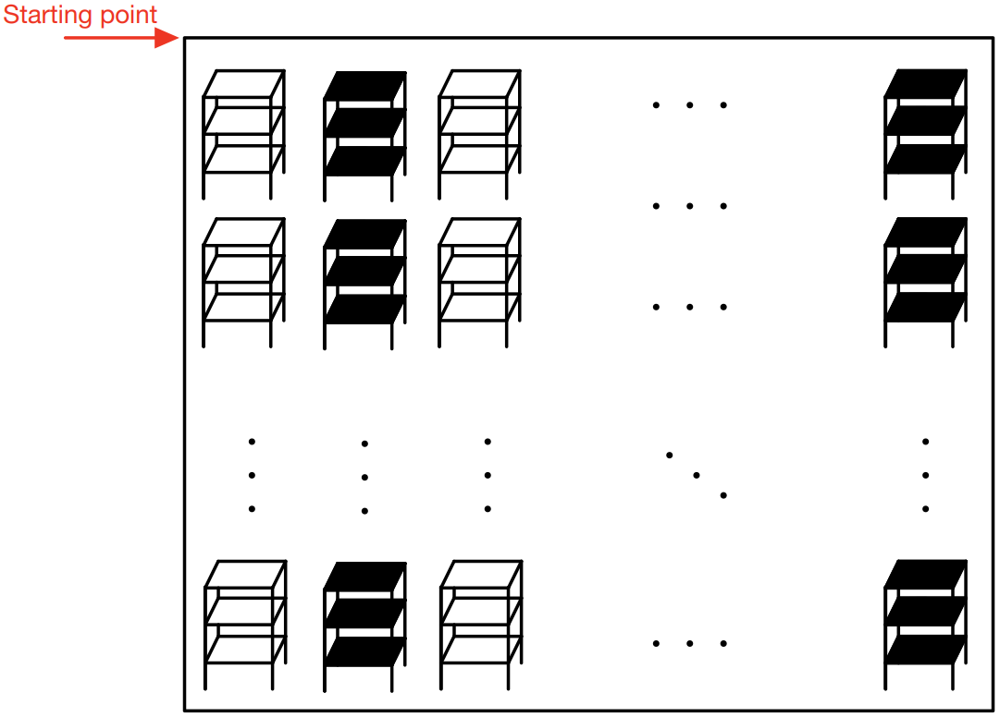
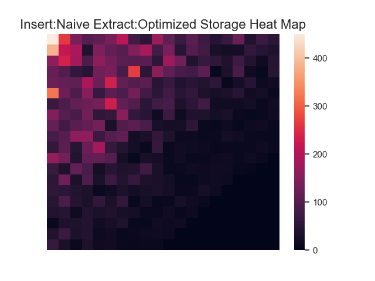
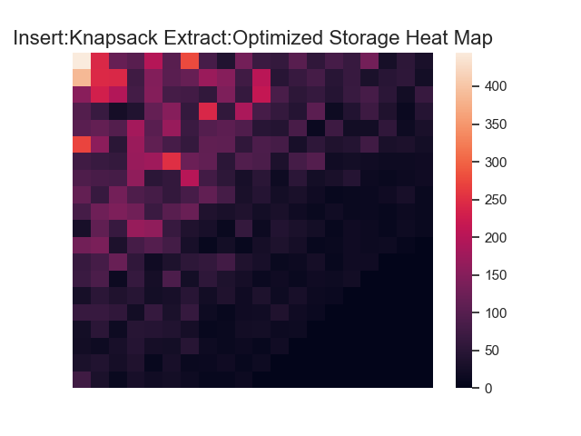
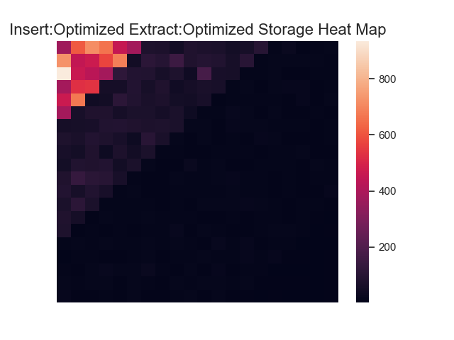

# SuperStorage
 
Simulating a storage environment while researching different insertion and extraction strategies.

## Illustration

  
   
   
 

## Introduction 

Let us assume that we have a robot that can read barcodes off packages and shelves in storage. The robot can be directed to insert packages to the storage and to extract packages from it. 

In this project, we are simulating a storage environment while researching different insertion and extraction strategies. Our goal is to implement an optimized algorithm that can surpass the knapsack algorithm. 

## Table of Contents
1. [Super Storage](docs/SuperStorage.md)
2. [UML Diagram](docs/UMLDiagram.PNG)
3. [How to run](docs/UserManual.md)
