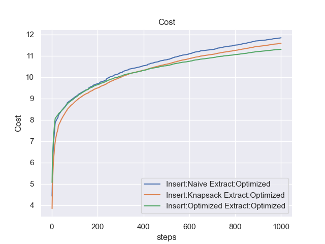
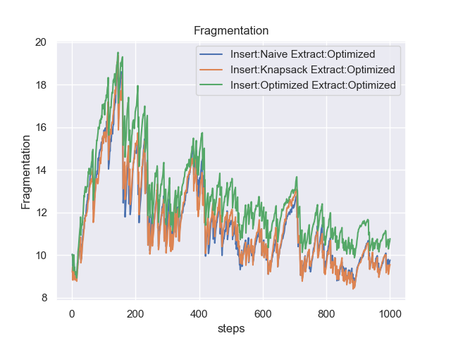

# SuperStorage
 
Simulating a storage environment while researching different insertion and extraction strategies.

## Illustration

  
   
   
 

## Introduction 

Let us assume that we have a robot that can read barcodes off packages and shelves in storage. The robot can be directed to insert packages to the storage and to extract packages from it. 

In this project, we are simulating a storage environment while researching different insertion and extraction strategies. Our goal is to implement an optimized algorithm that can surpass the knapsack algorithm. 

## How to run:

use run_simulation.py in root directory to run simulations.

usage: run_simulation.py [-h] [--ss_rows SS_ROWS]

                         [--ss_racks_per_row SS_RACKS_PER_ROW]
                         
                         [--ss_shelves_per_rack SS_SHELVES_PER_RACK]
                         
                         [--ss_shelf_size SS_SHELF_SIZE]
                         
                         [--operations_num OPERATIONS_NUM]
                         
                         [--insertion_headstart INSERTION_HEADSTART]
                         
                         [--extraction_probability EXTRACTION_PROBABILITY]
                         
                         [--exponential_scale EXPONENTIAL_SCALE]
                         
                         [--packages_per_container PACKAGES_PER_CONTAINER]
                         
                         [--products_per_order PRODUCTS_PER_ORDER]
                         
                         [--insert_lambda_coeff INSERT_LAMBDA_COEFF]
                         
                         [--extract_lambda_coeff EXTRACT_LAMBDA_COEFF]
                         
                         [--sector_bounds SECTOR_BOUNDS] [--export EXPORT]
                         
                         [--storage_managers STORAGE_MANAGERS [STORAGE_MANAGERS ...]]
                         

Super Storage Simulator

optional arguments:
  -h, --help            show this help message and exit
  --ss_rows SS_ROWS     Number of row in our SuperStorage
  --ss_racks_per_row SS_RACKS_PER_ROW
                        Number of racks per row in our SuperStorage
  --ss_shelves_per_rack SS_SHELVES_PER_RACK
                        Number of shelves per rack in our SuperStorage
  --ss_shelf_size SS_SHELF_SIZE
                        Size of shelves in our SuperStorage
  --operations_num OPERATIONS_NUM
                        Number of operations in this simulation
  --insertion_headstart INSERTION_HEADSTART
                        Number of insertions at the start of the simulation
  --extraction_probability EXTRACTION_PROBABILITY
                        The probability of drawing extraction operations
  --exponential_scale EXPONENTIAL_SCALE
                        Equal to 1/λ (λ is the parameter of exponential
                        distribution)
  --packages_per_container PACKAGES_PER_CONTAINER
                        Packages per one inserted container
  --products_per_order PRODUCTS_PER_ORDER
                        Products per one extraction order
  --insert_lambda_coeff INSERT_LAMBDA_COEFF
                        Coefficient for the insertion Poisson parameter
  --extract_lambda_coeff EXTRACT_LAMBDA_COEFF
                        Coefficient for the extraction Poisson parameter
  --sector_bounds SECTOR_BOUNDS
                        Sector Bounds for Optimized Algorithm
  --export EXPORT       Export results to files
  --storage_managers STORAGE_MANAGERS [STORAGE_MANAGERS ...], --sm STORAGE_MANAGERS [STORAGE_MANAGERS ...]
                        Adds a Storage Manager to run: --sm insert_algo,
                        extract_algo, ...sector_bounds? 
                        Examples: 
                        --sm knapsack, optimized
                        --sm optimized, optimized, 6, 9, 32 in this case 6, 9, 32 are the sector bounds

## Table of Contents
1. [Super Storage](docs/SuperStorage.md)
