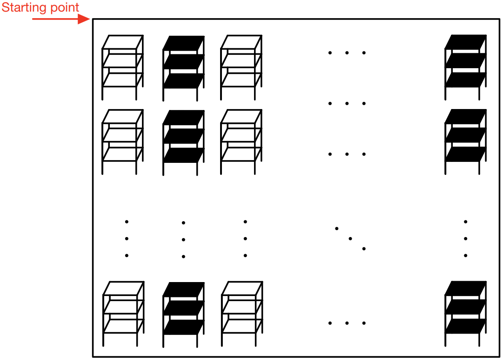
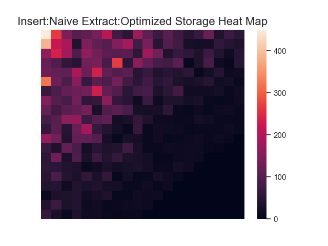
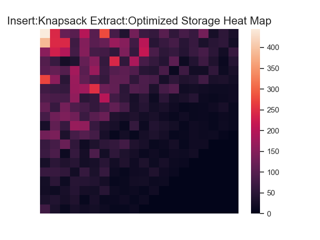
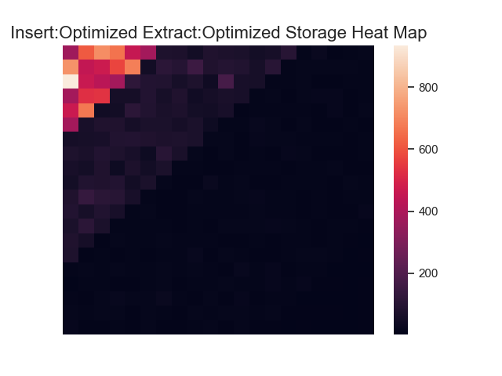
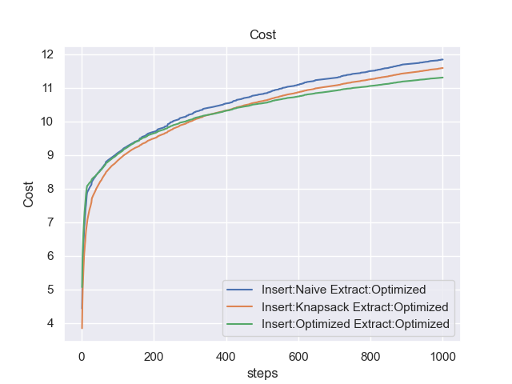
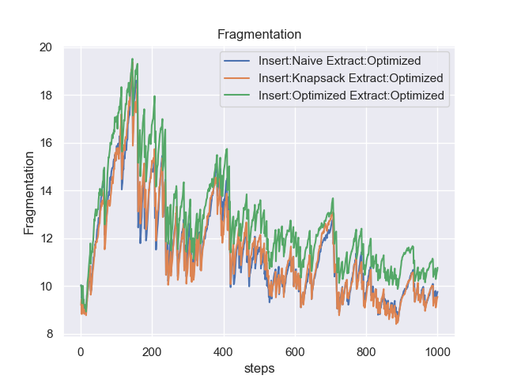

# SuperStorage
## Introduction
Let us assume that we have a robot that can read barcodes off packages and shelves in storage. The robot can be directed to insert packages to the storage and to extract packages from it. 

In this project, we are simulating a storage environment while researching different insertion and extraction strategies. Our goal is to implement an optimized algorithm that can surpass the knapsack algorithm. 

## Storage Description 

Let’s describe the physical storage properties we are using for our simulations. 

Our storage, Super Storage, is a rectangular space. It contains rows containing the same number of racks. 

Each rack has the same number of shelves. 

Spaces exist between rows and between columns alike; Our forklift can move across rows and columns alike. 

### Illustration:

	

## Storage Manager
As its name says, the Storage Manager manages the storage according to the strategy/algorithm set by the owner.  

Its main function is to deal with insertion/extraction requests. It also saves necessary information to be used on insertions/extractions.

## Strategies/Algorithms 

### Let’s start with Insertion Algorithms: 

1. **Naïve Insertion Algorithm:**

    Inserts every package in the container to the first available shelf. 

2. **Knapsack Insertion Algorithm:**

    We iterate shelves by distance and run a local knapsack algorithm on every one of them. Basically, for every shelf we pick a combination on the packages that utilizes the shelf’s size the most. 

3. Optimized Insertion Algorithm 
	
    An algorithm that partitions the storage to a number of sectors:
  
    - **Priority Items **

    - **Percentaged Sectors:** where we try to keep items' percentages in that area as of that in orders' distribution 

    - **Free Area **

  We use knapsack algorithm in each layer (regarding items that go to it) to minimize fragmentation. Also, items that didn’t fit in their matching sector will be delegated to the next sector. 

  We also optimize the forklift's insertion path through the storage. 

### As for Extraction Algorithms: 

1. **Naïve Extraction Algorithm** 

    Iterates positions by distance. Tries to extract order items from each position. 

2. **Optimized Extraction Algorithm **

    Iterates positions by distance without moving the forklift and saves positions where we need to extract from. After that we optimize a path starting and ending in our starting point while visiting all of these positions. 

    We will almost always use the Optimized Extraction Algorithm since it’s obviously better than the naïve one, hence using the naïve wouldn’t help in comparisons. 
	
## SIMULATION ENVIRONMENT DESCRIPTION
Our **Simulations** take multiple **Storage Managers** and run the same exact set of **operations** (insertions and extractions) on them: 

We have set up a dataset of 78 products that we use in our simulations.  

For each simulation **operation**, we choose if the next operation is going to be an insert or an extract (with a given **probability**). 

Then we **draw** a **container/order** based on distributions which will be explained, and we request each storage manager to execute it. 

## CONTAINER/ORDER DISTRIBUTIONS 

We draw containers for insert and orders for extract in a similar way.  

Let’s explain drawing a **container** for **insertion** : 

  - Assume **n** is the number of packages in this container 

  - We draw **n** numbers (items) between 0 and 77 using **exponential** distribution. 

  - Now for each item we draw a quantity according to a **Poisson** distribution. 

**Drawing** orders for **extractions** is **similar**, we use **different parameters** for distributions and numbers of items in a single order. 

## Distribution Parameters 

The exponential distribution parameter is the same for both insertions and extractions. 

Poisson parameter (λ) differs: 

  - Assume **n** is the number (or expectancy) of packages in containers 

  - Assume **m** is the number (or expectancy) of products in orders 

  - Assume **p** is the probability of extraction operations 

  - Insertions: (Assuming ic is insertion coeff)

$$ \lambda ={\\frac{p}{1-p}}∗ic $$

  - Extractions: (Assuming ec is extraction coeff)

$$ \lambda ={\\frac{n}{m}}∗ec $$
 
  - This is to make sure that using neutral/equal coefficients leads to a balanced storage (items that go in are expected to go out). 

## Simulation Parameters
| Parameter  | Description | Value Example  |
| ------------- | ------------------------------- | --------- 
| storage_managers_settings | Contains the settings of storage managers to be run in this simulation | [ StorageManagerSettings(InsertAlgorithm.NAIVE,ExtractAlgorithm.OPTIMIZED), StorageManagerSettings(InsertAlgorithm.KNAPSACK, ExtractAlgorithm.OPTIMIZED), StorageManagerSettings(InsertAlgorithm.OPTIMIZED, ExtractAlgorithm.OPTIMIZED, sector_bounds=[6, 15, 32])]  |
| storage_settings   | Storage Settings  | StorageSettings(rows=20, racks_per_row=20, shelves_per_rack=10, shelf_size=200)  |
| operations_num   | Number of operations   | 1000  | 
| insertion_headstart   | Number of insertions at the start of the simulation   | 10  | 
| extraction_probability   | The probability of drawing extraction operations  | 7/10 |
| exponential_scale   | Equal to 1/λ (λ is the parameter of exponential distribution) | 20  | 
| packages_per_container | Packages per container | 10  | 
| products_per_order | Products per order  | 5  | 
| insert_lambda_coeff | Coefficient for the insertion Poisson parameter | 3  | 
| extract_lambda_coeff | Coefficient for the extraction Poisson parameter | 2.5  | 
| export | Export results to files | True  | 

## Other Definitions

### Position: 

a position in the storage is defined as (row, col, shelf). 

### Cost:

The total cost of forklift movements inside the storage. Each move’s cost is defined as: 

(hc <- horizontal coeff, vc <- vertical coeff, horizontal_coeff >> vertical_coeff)

$$ Cost(A→B) = hc∗|A.row−B.row|+ vc∗|A.shelf−B.shelf| $$

### Fragmentation:

we defined fragmentation as the percentage of unused space across all used shelves.

## TESTS AND RESULTS 

### Simulation parameters: 

- Storage managers tested: 

  - Insert: Naïve, Extract: Optimized 

  - Insert: Knapsack, Extract: Optimized 

  - Insert: Optimized, Extract: Optimized, Sector Bounds: [6, 15, 32] 

- Storage Settings: 

  - Rows: 20 

  - Racks Per Row: 20 

  - Shelves Per Rack: 10 

  - Shelf Size: 200 

- Extraction Probability: 0.9 

- Operations number: 1000 

- Packages Per Container: 30 

- Products Per Order: 10 

- Insertion Head start: 15 

- Insert Lambda Coefficient: 3 

- Extract Lambda Coefficient: 2.5 

### Results:

   
   
 

## CONCLUSIONS

### Fragmentation
As seen in **Fragmentation** graphs, **Knapsack Algorithm** as expected provided the best results among all insertion algorithms. We can also see that the Optimized Algorithm provided the highest fragmentation among all. This is caused by our selective sectors which worsens our ability to optimize unused spaces.

### Costs and Activity Heatmaps
Using the right parameters for **Optimized Algorithm**, we can utilize the information we have about ordering patterns to get better results. We set a sector for prioritized items (the ones that get ordered frequently) and put them close to our forklift’s starting point. This led to much lower costs, especially in the **long term**. Also, our second sector (**percentaged**) is being used frequently enough. This led to much **lower activity space**, which unexpectedly also led to **lower insertion costs**. We were initially expecting extraction costs to make up for the rise in insertion costs.

Also, looking at the heatmaps of the **Knapsack Algorithm** and the **Naïve Algorithm** are somewhat similar. Hence their Extraction Cost Graphs look **identical**.

Also, as expected, **Knapsack Algorithm** always outperformed the **Naïve Algorithm**. Which meant we only needed to compare our Optimized Algorithm with the Knapsack Algorithm.

